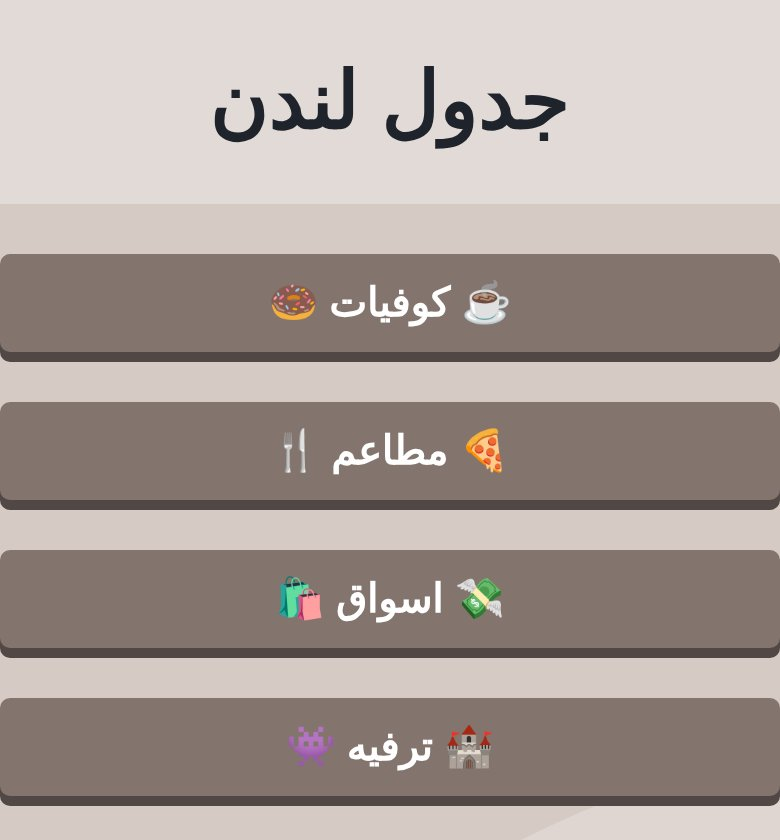

# London Trip Planner

**Live site:** https://irbala.github.io/London/

  
  

Click a screenshot to open the live site.

An Arabic (right-to-left) trip planner I made for a family trip to London and Brighton. Each page lists places as cards, and every place has a button for its Instagram page and a button that opens it in Google Maps. The home page shows the London weather.

## Pages

| Page | What's on it |
|---|---|
| `index.html` | Menu and weather |
| `coffee.html` | Cafes and desserts |
| `food.html` | Restaurants |
| `shopping.html` | Markets and shops |
| `entertainment.html` | Things to do |
| `brighton.html` | Places to eat and sights in Brighton |

## How it's built

- HTML and CSS, with one stylesheet (`style.css`) shared by every page
- Place cards sit in two columns on wide screens and one column on phones
- The Instagram and map icons are two small SVG files in `img/`
- The only JavaScript is the weather widget from Tomorrow.io on the home page

## Design Decisions

- **Made for phones on the go.** The home page is a short list of big, full-width buttons, one per category, so family members can find a café or restaurant with one tap while walking around.
- **Two actions per place.** Every card has an Instagram button (to see photos and the menu) and a Google Maps button (to get there), the two things you need when deciding where to go next.
- **Warm, neutral palette.** Greige backgrounds and taupe buttons stay out of the way so the place photos stand out. <!-- guess: Fay, please confirm or edit -->
- **Arabic layout with a system font.** Pages are `lang="ar" dir="rtl"` and use the device's own font, so there is nothing extra to download on mobile data abroad. <!-- guess: Fay, please confirm or edit -->
- **Useful extras.** The London weather on the home page, and the Saudi Ministry of Foreign Affairs number (920011114) always visible for emergencies.

## Accessibility

Checked on 19 November 2026 with [axe-core](https://github.com/dequelabs/axe-core) 4.10, the engine behind Lighthouse's accessibility score, against WCAG 2.1 A and AA plus axe's best-practice rules. Every page was tested in a desktop browser.

| Page | Issues | Rules passed |
|---|---|---|
| `brighton.html` | ✅ 0 issues | 31 |
| `coffee.html` | ✅ 0 issues | 31 |
| `entertainment.html` | ✅ 0 issues | 30 |
| `food.html` | ✅ 0 issues | 31 |
| `index.html` | ✅ 0 issues | 25 |
| `shopping.html` | ✅ 0 issues | 30 |

Note: place photos are loaded from other websites, so a few may stop loading if those sites change.

## Run it locally

Download or clone the repo and open `index.html` in a browser.
